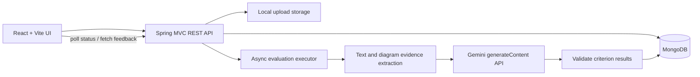

# Design Note — DesignLoop Backend

## 1. Goal

The backend supports an LLD learning loop: select a problem, prepare design evidence, save a draft, submit an immutable snapshot, receive rubric-based feedback, and revisit previous attempts. The learner is evaluated on the quality of the explanation and design evidence, not on whether the answer matches one hard-coded reference class diagram.

## 2. High-level architecture

The API returns `202 Accepted` after saving and freezing the submission and queues evaluation on a bounded async executor. Status transitions are stored in the attempt timeline. Evaluation never needs the browser request to remain open while a model is responding.

## 3. Main components

- `ProblemController` and `ProblemSeeder`: publish six starter problems and their problem-specific requirements/change scenarios plus a shared rubric.
- `AttemptController` / `AttemptService`: create attempts, save optimistic revisions, validate formats, freeze a submission snapshot, enforce idempotency, maintain ownership by demo learner ID, and provide history/status.
- `AttachmentService`: validates extension and size, writes binary files to local storage under a generated identifier, extracts supported document text with Apache Tika, and prepares visual evidence for diagram review.
- `EvaluationWorker`: runs outside the submit request, records `EVALUATING`, persists completed feedback, or marks a failed run retryable when a run remains.
- `DesignReviewEvaluator`: builds problem-specific evaluation instructions, validates the model response against the problem rubric, computes the weighted total, and produces honest readiness-only feedback when no key is configured.
- `GeminiClient`: makes a server-side REST call to Gemini. The API key is loaded only from environment configuration.
- `AttemptViewMapper`: returns safe attachment metadata and never exposes the server's storage paths or extracted document contents in normal attempt responses.

## 4. Domain data

### Problem

A problem contains its stable ID, title, difficulty, estimated duration, description, category, required behaviours, assumptions, out-of-scope items, a change scenario, and criterion weights. The same submission interface works for every problem.

### Attempt

An attempt includes a learner ID, selected problem snapshot, format, current editable draft, optimistic revision, status, attachment metadata, optional frozen submission, evaluation run metadata, optional feedback, failure message, and timeline. MongoDB stores the document. Uploaded bytes are stored separately on disk so large files do not consume the MongoDB 16 MB document budget.

### Submission snapshot

At submit time the server copies the latest draft, records the exact revision, associated attachment IDs, timestamp and SHA-256 fingerprint. It then changes the attempt status from `DRAFT` to `SUBMITTED`. Draft edits and uploads are blocked once submitted. This preserves the evidence that was actually reviewed.

## 5. Input modalities

- **Text**: structured evidence sections — requirements, responsibilities, relationships, behaviour, trade-offs, tests, optional code.
- **Document**: file upload; supported document formats are extracted to bounded plain text for review.
- **Diagram**: image/PDF page evidence is sent as visual input when supported. SVG and Draw.io/XML source is provided as textual markup evidence. Diagram review should not infer details that are unreadable.
- **Combined**: structured text plus at least one attached document or diagram.

The `code` section is a text evidence source only. The backend does not compile or execute submitted code.

## 6. Evaluation rubric

The weighted 100-point result is computed by the server from eight criterion scores. Each score is an integer from 0 to 4.

| Criterion | Weight |
|---|---:|
| Requirement understanding | 15 |
| Class responsibilities | 20 |
| Coupling and cohesion | 15 |
| Encapsulation and interfaces | 10 |
| Appropriate abstraction | 10 |
| Extensibility/change scenario | 10 |
| Edge cases and testability | 15 |
| Explanation quality | 5 |
| **Total** | **100** |

For a criterion score `s` and weight `w`, the contribution is `s / 4 × w`. The total is rounded to the nearest integer. A malformed model response or missing score fails evaluation instead of generating a fabricated score. A valid feedback result includes evidence quotes, concern and a concrete suggestion for every criterion.

## 7. Reliability

- Draft writes compare `expectedRevision` and also use MongoDB versioning to detect concurrent stale writes in a single shared database.
- Submission requires an idempotency key. A repeated submit does not start another model run for the same frozen attempt.
- Evaluation is asynchronous and has a bounded run count. `FAILED` records a learner-safe explanation while preserving the frozen submission.
- Retry reuses the saved submission and attachments rather than asking the learner to upload again.
- No-key mode is labelled `RULES` / `READINESS_ONLY` and returns null scores.

## 8. Scope and trade-offs

This is a single-service educational prototype. Local disk upload storage keeps setup simple; a deployed multi-instance service should move to private object storage. `X-Learner-Id` supports local demonstration only and must be replaced by real authentication and authorization before public exposure. The API does not execute learner code or implement a real payment/inventory workflow; those are LLD problem statements for learners to design.
